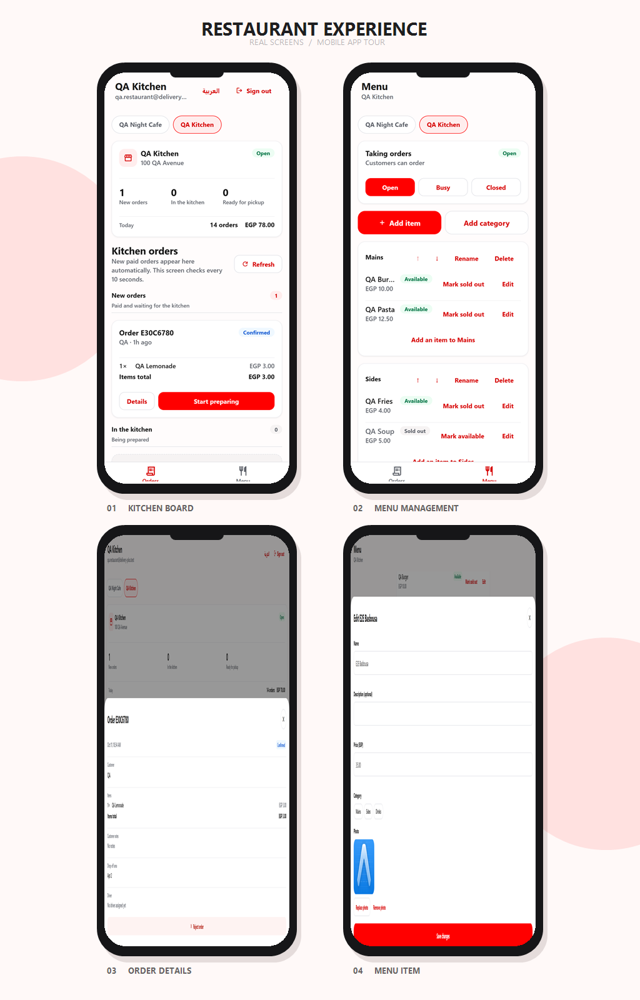

<p align="center">
  
  &nbsp;&nbsp;
  
</p>

<h1 align="center">Delivery Plus Restaurant App</h1>

<p align="center">Manage kitchen orders, menu availability and restaurant status from one dashboard.</p>

<p align="center">
  <strong>DELIVERY PLUS</strong>
  &nbsp; × &nbsp;
  <a href="https://expo.dev"></a>
</p>

<p align="center">
  <a href="https://github.com/Delivery-Plus0/delivery-plus-restaurant-app"></a>
  
  
  
</p>

Built with **Expo 57 / React Native 0.86 / Expo Router / TypeScript**, web-first (desktop and narrow browser widths), on the same foundation and design system as the [customer app](https://github.com/Delivery-Plus0/delivery-plus-customer-app) and the [driver app](https://github.com/Delivery-Plus0/delivery-plus-driver-app): API client, session handling, `useResource` cache and polling, UI kit and theme, lint and test setup. It talks only to the Delivery Plus API gateway; the backend lives in [Delivery-Plus0/delivery-plus](https://github.com/Delivery-Plus0/delivery-plus) (issue #100).

## App gallery

<p align="center">
  <a href="./identity/mobile-screens.png"></a>
</p>

Four real screens from the running app, presented in rounded phone frames. Captured at phone width from the web build with seeded QA data.

## Features (MVP)

| Area | What works | Backend contract |
| --- | --- | --- |
| Account | Sign in (RESTAURANT_OWNER accounts only; other roles are refused before a session is stored). Owner accounts are provisioned by the backend | `POST /api/auth/login` |
| Restaurants | The owner's restaurants; opens the first one taking orders, with a picker when there are several | `GET /api/restaurants/me` (#59, scoped to the token) |
| Order board | Lanes *New orders* (CONFIRMED), *In the kitchen* (PREPARING), *Ready for pickup*; items, totals and age per order; other orders on request; polled every 10 s, pull to refresh | `GET /api/orders/restaurant/:restaurantId` (owner role + ownership) |
| Kitchen actions | One button per order: *Start preparing* → *Ready for pickup*. Ready triggers automatic dispatch; there is no dispatch screen | `PATCH /api/orders/:id/status` (`PREPARING`, `READY_FOR_PICKUP`) |
| Restaurant status (Menu tab) | *Open / Busy / Closed*; locked while an admin has the restaurant SUSPENDED | `PATCH /api/restaurants/:id/status` |
| Item availability (Menu tab) | The menu by category; each item *Available / Sold out* with one toggle | `GET /api/menus/restaurants/:id/menu`, `PATCH /api/menus/menu-items/:id/availability` |

Payment owns `CONFIRMED`; the app never offers payment, cancellation or driver assignment. Not yet built: menu editing (prices, new items, images), opening hours, order pagination beyond the newest 50. Backend gap: owners can still set or lift `SUSPENDED` through the API (delivery-plus #125); the app doesn't offer it.

## Getting started

Requirements: Node.js 22 and the backend dev stack (gateway on `http://localhost:3000`).

```bash
cp .env.example .env.local     # EXPO_PUBLIC_API_BASE_URL=http://localhost:3000
npm ci
npm run web
```

Demo owner (after `npm run seed` in the backend): see the backend seed output. On the E2E stack (`:3100`): `qa.restaurant@delivery-plus.test`.

## Project structure

```text
src/
├── app/            Expo Router screens: (auth)/login, (app)/(tabs)/home (Orders board) and menu (status + availability); (app)/_layout guards the owner role
├── components/     UI kit shared with the customer and driver apps (screen, cards, badges, buttons, inputs, alerts, state views) + restaurant-order-card, restaurant-picker
├── services/       API client (api.ts), session, auth, restaurants (owner's restaurants), restaurant-orders (list, status), menus (menu, availability)
├── state/          restaurant.ts: shared restaurant selection, useRestaurantOrders (polling), useRestaurantMenu, advanceOrder, setItemAvailability, setRestaurantStatus; resource-cache
├── hooks/          useResource (cache, polling, in-flight dedupe), theme hooks
├── utils/          order-status (labels, lanes, next kitchen step, restaurant selection), availability (owner statuses, menu grouping), formatting, login errors (unit-tested)
└── test/           Test setup
```

## Testing

| Level | Command |
| --- | --- |
| Typecheck | `npm run typecheck` |
| Lint (zero warnings) | `npm run lint` |
| Unit tests (vitest) | `npm test` |
| Web export | `npm run export:web` |
| UI / E2E (Maestro, against the backend's isolated E2E stack) | `npm run e2e:smoke -- --build --headless`, `npm run e2e:all -- --headless` |

See [e2e/README.md](e2e/README.md) for the suites, test data and how to run them.

## CI, branches and contributing

CI runs typecheck, lint, unit tests and a web export; the E2E workflow runs the Maestro smoke suite on every PR (everything nightly); the Security workflow runs `npm audit` and a Trivy filesystem/secret scan. `dev` is the default branch, `testing` and `main` follow the backend's model. See [CONTRIBUTING.md](CONTRIBUTING.md), [SECURITY.md](SECURITY.md) and [CODE_OF_CONDUCT.md](CODE_OF_CONDUCT.md).

## License

See [LICENSE](LICENSE).
