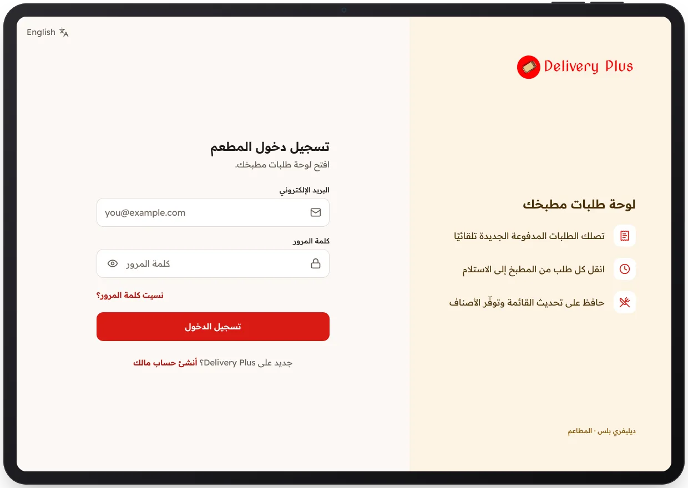

<!-- Generated from the app's web build (screens in docs/screens); regenerate rather than edit by hand. -->

[تطبيق المطعم](../../../README.md) › [الشاشات](../README.md) › 1 من 10 · [English](../en/01-sign-in.md)

<h1 align="center">تسجيل الدخول</h1>

لأصحاب المطاعم، ويمكن للمالك الجديد إنشاء حساب من هنا.

→ السابق &nbsp;·&nbsp; <b>1 / 10</b> &nbsp;·&nbsp; <a href="02-onboarding-details.md">التالي ←</a>

