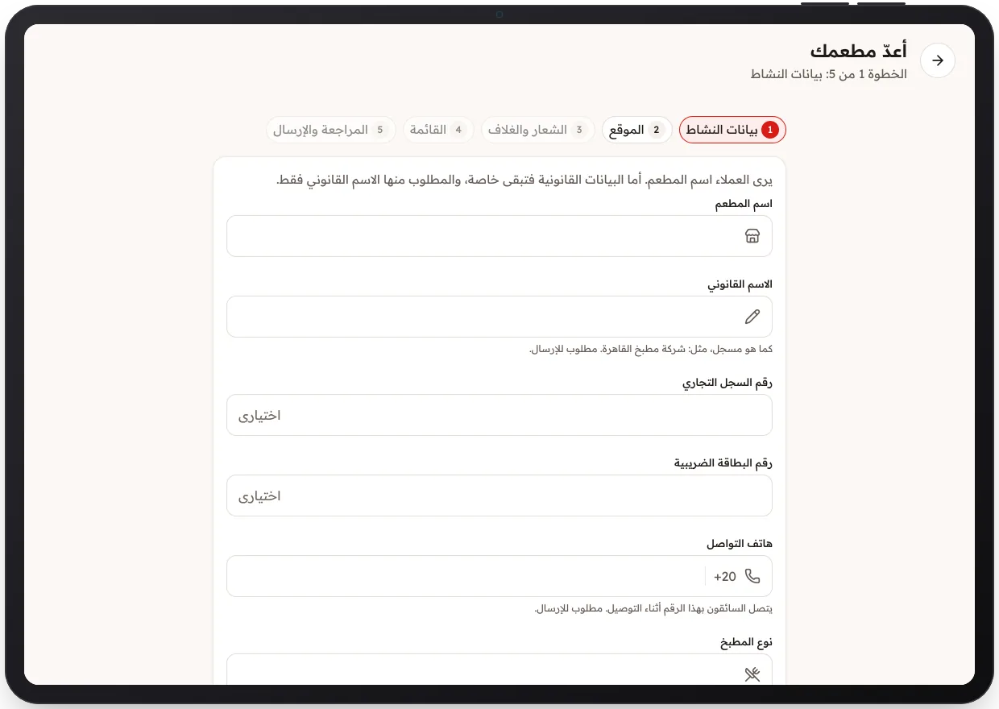

<!-- Generated from the app's web build (screens in docs/screens); regenerate rather than edit by hand. -->

[تطبيق المطعم](../../../README.md) › [الشاشات](../README.md) › 2 من 10 · [English](../en/02-onboarding-details.md)

<h1 align="center">إعداد المطعم</h1>

الخطوة 1 من 5: الاسم والاسم القانوني والهاتف ونوع المطبخ.

<a href="01-sign-in.md">→ السابق</a> &nbsp;·&nbsp; <b>2 / 10</b> &nbsp;·&nbsp; <a href="03-onboarding-location.md">التالي ←</a>

