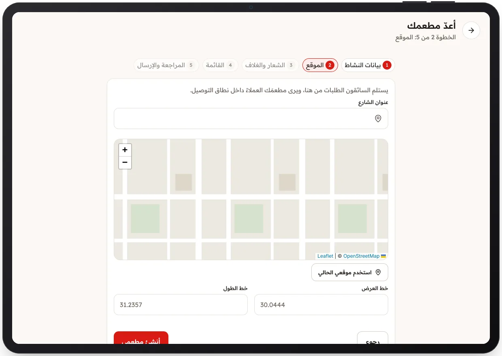

<!-- Generated from the app's web build (screens in docs/screens); regenerate rather than edit by hand. -->

[تطبيق المطعم](../../../README.md) › [الشاشات](../README.md) › 3 من 10 · [English](../en/03-onboarding-location.md)

<h1 align="center">الموقع</h1>

الخطوة 2: العنوان وعلامة على الخريطة، ويرى المطعمَ العملاءُ داخل نطاق التوصيل.

<a href="02-onboarding-details.md">→ السابق</a> &nbsp;·&nbsp; <b>3 / 10</b> &nbsp;·&nbsp; <a href="04-onboarding-review.md">التالي ←</a>

