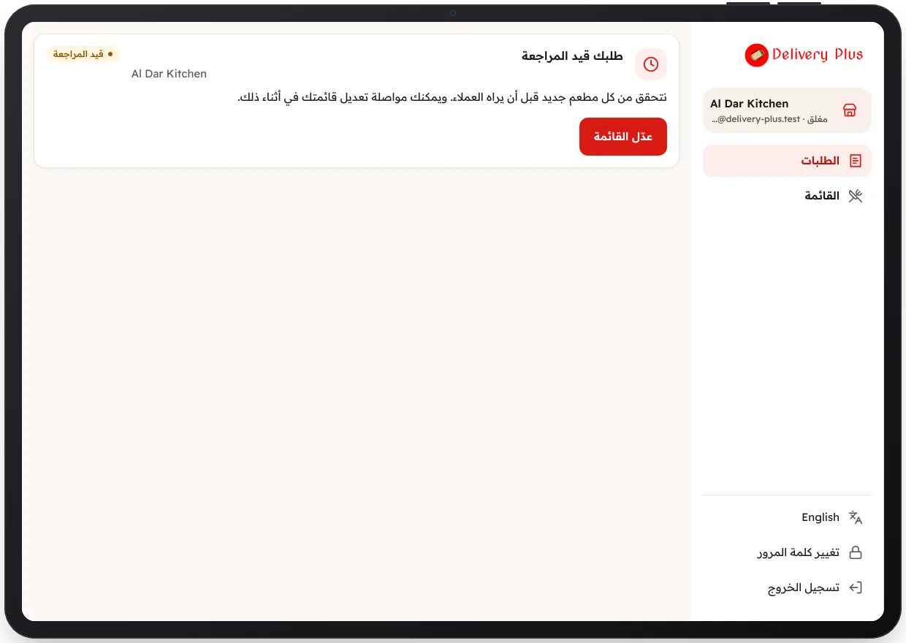

<!-- Generated from the app's web build (screens in docs/screens); regenerate rather than edit by hand. -->

[تطبيق المطعم](../../../README.md) › [الشاشات](../README.md) › 5 من 10 · [English](../en/05-under-review.md)

<h1 align="center">قيد المراجعة</h1>

الطلب لدى فريقنا، ويفتح المطعم بعد الموافقة.

<a href="04-onboarding-review.md">→ السابق</a> &nbsp;·&nbsp; <b>5 / 10</b> &nbsp;·&nbsp; <a href="06-orders-board.md">التالي ←</a>

