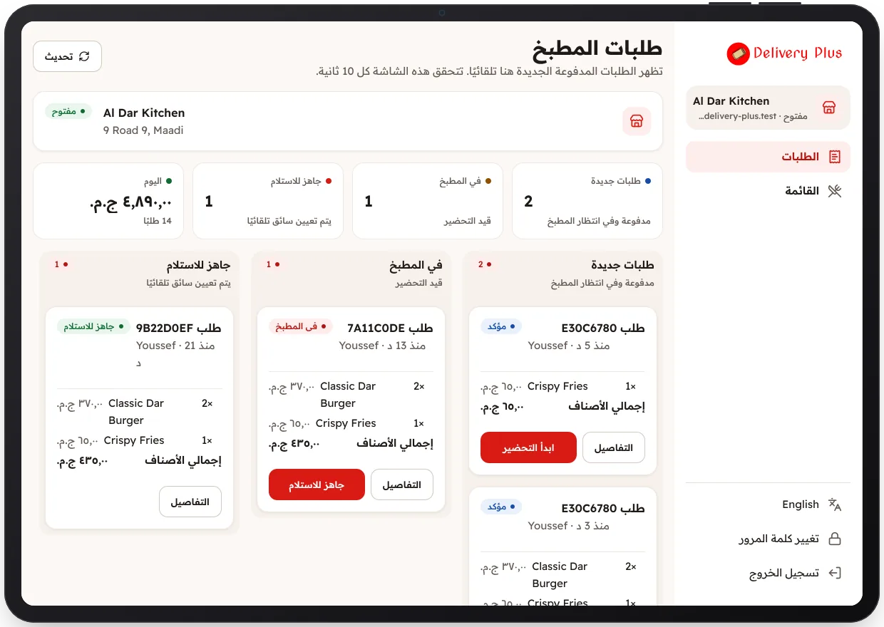

<!-- Generated from the app's web build (screens in docs/screens); regenerate rather than edit by hand. -->

[تطبيق المطعم](../../../README.md) › [الشاشات](../README.md) › 6 من 10 · [English](../en/06-orders-board.md)

<h1 align="center">لوحة المطبخ</h1>

أرقام اليوم والطلبات حسب المرحلة: جديد، قيد التحضير، جاهز.

<a href="05-under-review.md">→ السابق</a> &nbsp;·&nbsp; <b>6 / 10</b> &nbsp;·&nbsp; <a href="07-order-details.md">التالي ←</a>

