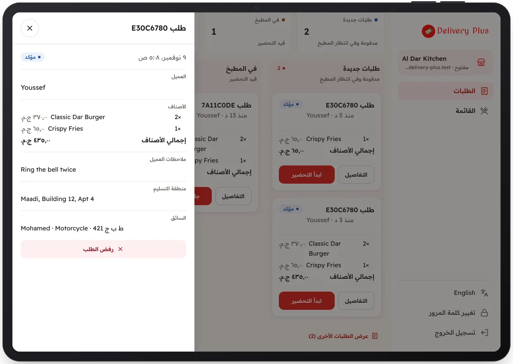

<!-- Generated from the app's web build (screens in docs/screens); regenerate rather than edit by hand. -->

[تطبيق المطعم](../../../README.md) › [الشاشات](../README.md) › 7 من 10 · [English](../en/07-order-details.md)

<h1 align="center">تفاصيل الطلب</h1>

الأصناف والملاحظات ومنطقة التوصيل والإجمالي.

<a href="06-orders-board.md">→ السابق</a> &nbsp;·&nbsp; <b>7 / 10</b> &nbsp;·&nbsp; <a href="08-reject-order.md">التالي ←</a>

