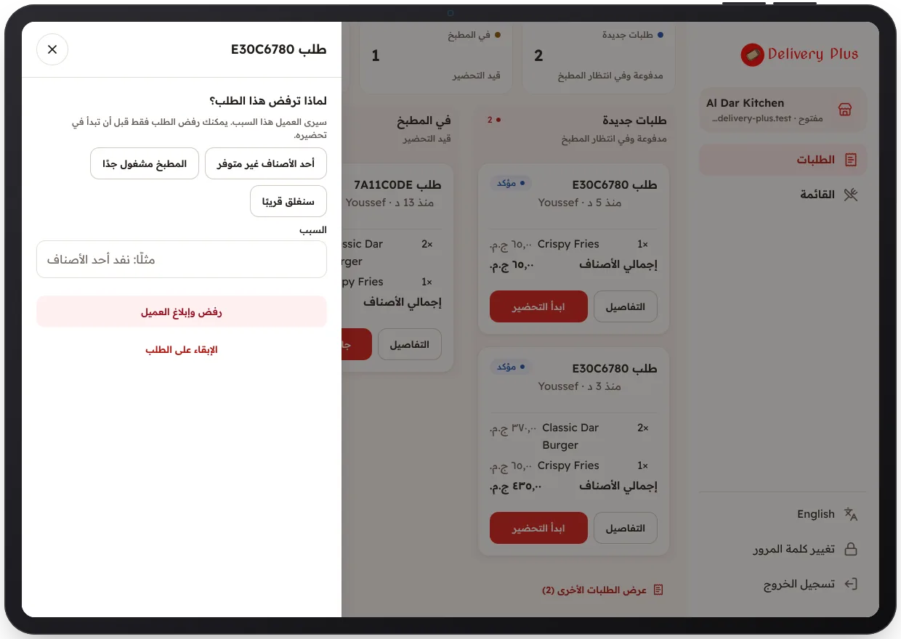

<!-- Generated from the app's web build (screens in docs/screens); regenerate rather than edit by hand. -->

[تطبيق المطعم](../../../README.md) › [الشاشات](../README.md) › 8 من 10 · [English](../en/08-reject-order.md)

<h1 align="center">الرفض مع ذكر السبب</h1>

يُبلَّغ العميل بالسبب ويُسترد المبلغ.

<a href="07-order-details.md">→ السابق</a> &nbsp;·&nbsp; <b>8 / 10</b> &nbsp;·&nbsp; <a href="09-menu.md">التالي ←</a>

