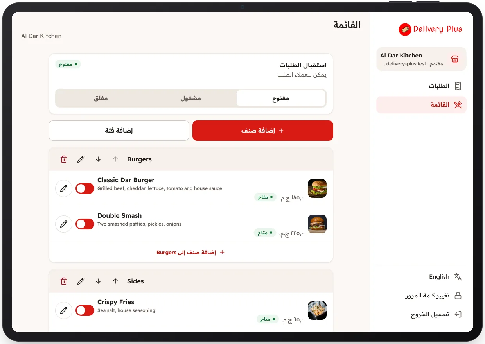

<!-- Generated from the app's web build (screens in docs/screens); regenerate rather than edit by hand. -->

[تطبيق المطعم](../../../README.md) › [الشاشات](../README.md) › 9 من 10 · [English](../en/09-menu.md)

<h1 align="center">قائمة الطعام</h1>

الأقسام والأصناف والتوفر، وحالة المطعم: مفتوح أو مشغول أو مغلق.

<a href="08-reject-order.md">→ السابق</a> &nbsp;·&nbsp; <b>9 / 10</b> &nbsp;·&nbsp; <a href="10-edit-item.md">التالي ←</a>

