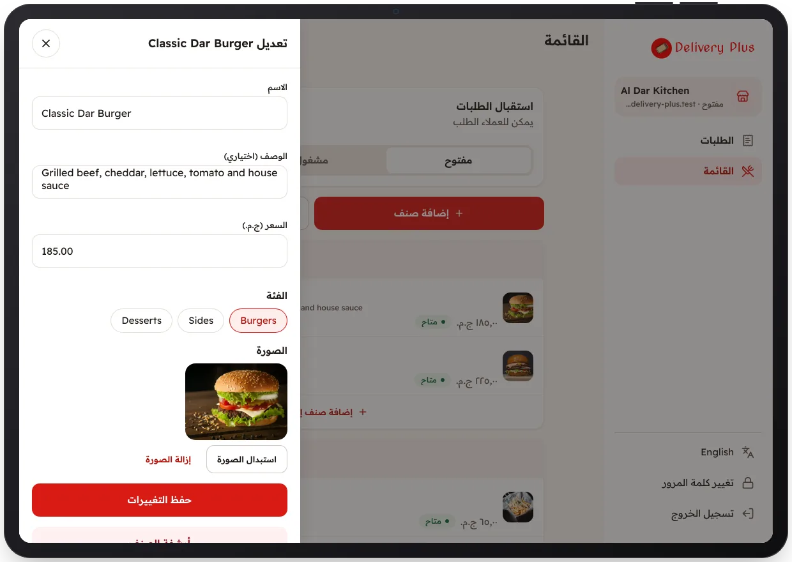

<!-- Generated from the app's web build (screens in docs/screens); regenerate rather than edit by hand. -->

[تطبيق المطعم](../../../README.md) › [الشاشات](../README.md) › 10 من 10 · [English](../en/10-edit-item.md)

<h1 align="center">تعديل صنف</h1>

الاسم والوصف والسعر والقسم والصورة.

<a href="09-menu.md">→ السابق</a> &nbsp;·&nbsp; <b>10 / 10</b> &nbsp;·&nbsp; التالي ←

