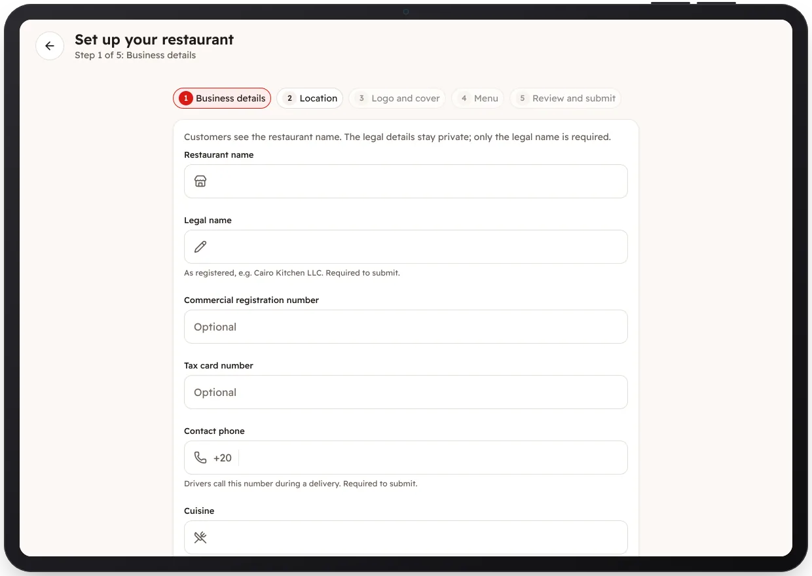

<!-- Generated from the app's web build (screens in docs/screens); regenerate rather than edit by hand. -->
[Restaurant app](../../../README.md) › [Screens](../README.md) › 2 of 10 · [العربية](../ar/02-onboarding-details.md)

<h1 align="center">Set up your restaurant</h1>

Step 1 of 5: name, legal name, phone and cuisine.

<a href="01-sign-in.md">← Previous</a> &nbsp;·&nbsp; <b>2 / 10</b> &nbsp;·&nbsp; <a href="03-onboarding-location.md">Next →</a>

