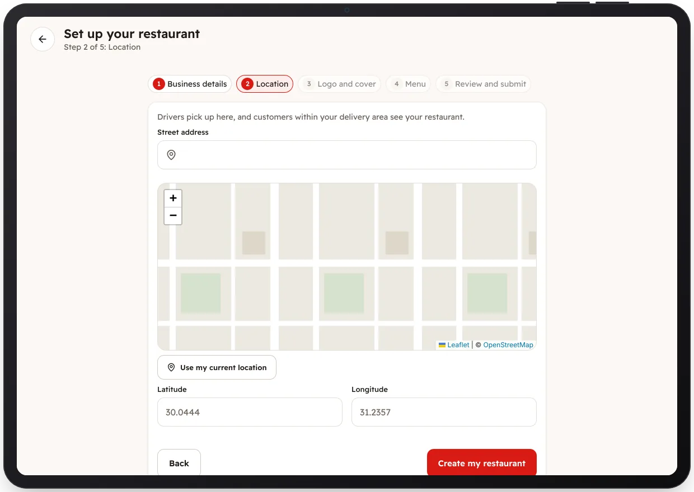

<!-- Generated from the app's web build (screens in docs/screens); regenerate rather than edit by hand. -->
[Restaurant app](../../../README.md) › [Screens](../README.md) › 3 of 10 · [العربية](../ar/03-onboarding-location.md)

<h1 align="center">Location</h1>

Step 2: the address and a pin on the map; customers within the delivery radius see the restaurant.

<a href="02-onboarding-details.md">← Previous</a> &nbsp;·&nbsp; <b>3 / 10</b> &nbsp;·&nbsp; <a href="04-onboarding-review.md">Next →</a>

