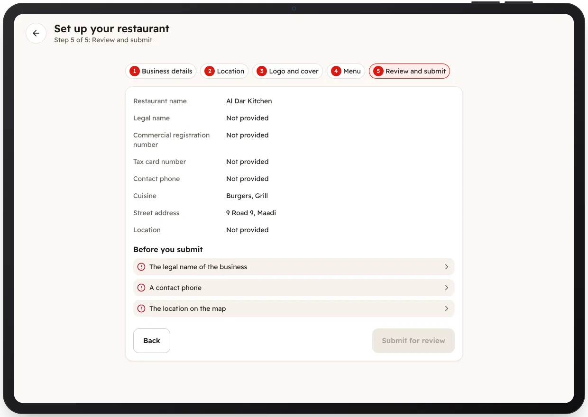

<!-- Generated from the app's web build (screens in docs/screens); regenerate rather than edit by hand. -->
[Restaurant app](../../../README.md) › [Screens](../README.md) › 4 of 10 · [العربية](../ar/04-onboarding-review.md)

<h1 align="center">Review and submit</h1>

What is still missing before the application can be submitted.

<a href="03-onboarding-location.md">← Previous</a> &nbsp;·&nbsp; <b>4 / 10</b> &nbsp;·&nbsp; <a href="05-under-review.md">Next →</a>

