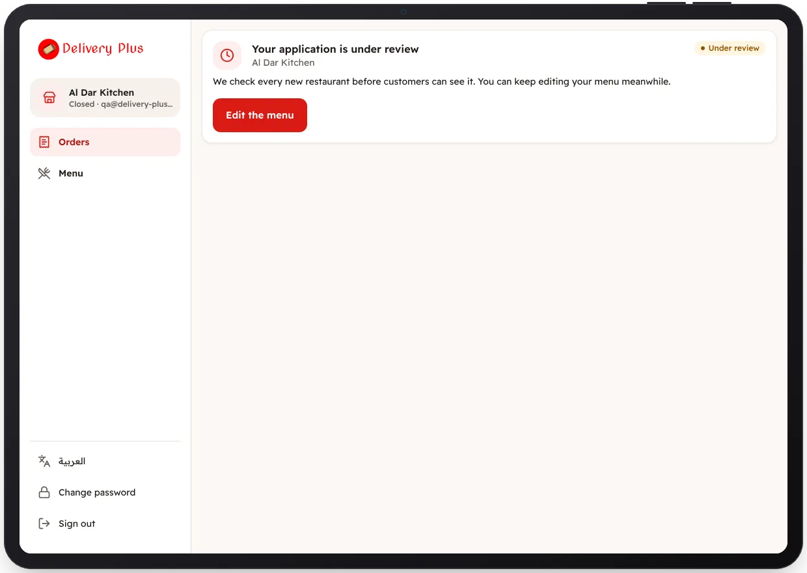

<!-- Generated from the app's web build (screens in docs/screens); regenerate rather than edit by hand. -->
[Restaurant app](../../../README.md) › [Screens](../README.md) › 5 of 10 · [العربية](../ar/05-under-review.md)

<h1 align="center">Under review</h1>

The application is with our team; the restaurant opens once approved.

<a href="04-onboarding-review.md">← Previous</a> &nbsp;·&nbsp; <b>5 / 10</b> &nbsp;·&nbsp; <a href="06-orders-board.md">Next →</a>

