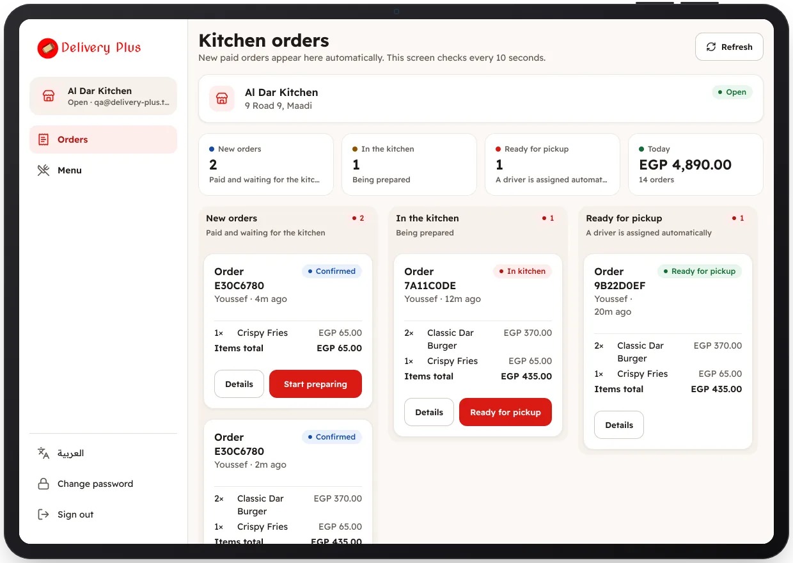

<!-- Generated from the app's web build (screens in docs/screens); regenerate rather than edit by hand. -->
[Restaurant app](../../../README.md) › [Screens](../README.md) › 6 of 10 · [العربية](../ar/06-orders-board.md)

<h1 align="center">Kitchen board</h1>

Today's numbers and the orders by stage: new, preparing, ready.

<a href="05-under-review.md">← Previous</a> &nbsp;·&nbsp; <b>6 / 10</b> &nbsp;·&nbsp; <a href="07-order-details.md">Next →</a>

