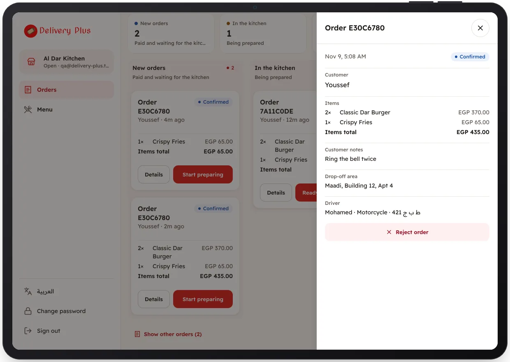

<!-- Generated from the app's web build (screens in docs/screens); regenerate rather than edit by hand. -->
[Restaurant app](../../../README.md) › [Screens](../README.md) › 7 of 10 · [العربية](../ar/07-order-details.md)

<h1 align="center">Order details</h1>

Items, notes, the delivery area and the total.

<a href="06-orders-board.md">← Previous</a> &nbsp;·&nbsp; <b>7 / 10</b> &nbsp;·&nbsp; <a href="08-reject-order.md">Next →</a>

