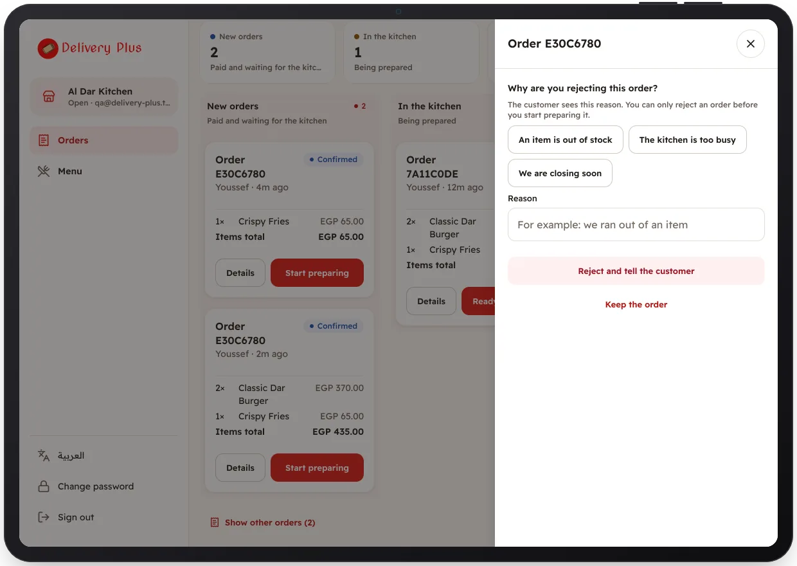

<!-- Generated from the app's web build (screens in docs/screens); regenerate rather than edit by hand. -->
[Restaurant app](../../../README.md) › [Screens](../README.md) › 8 of 10 · [العربية](../ar/08-reject-order.md)

<h1 align="center">Reject with a reason</h1>

The customer is told why, and refunded.

<a href="07-order-details.md">← Previous</a> &nbsp;·&nbsp; <b>8 / 10</b> &nbsp;·&nbsp; <a href="09-menu.md">Next →</a>

