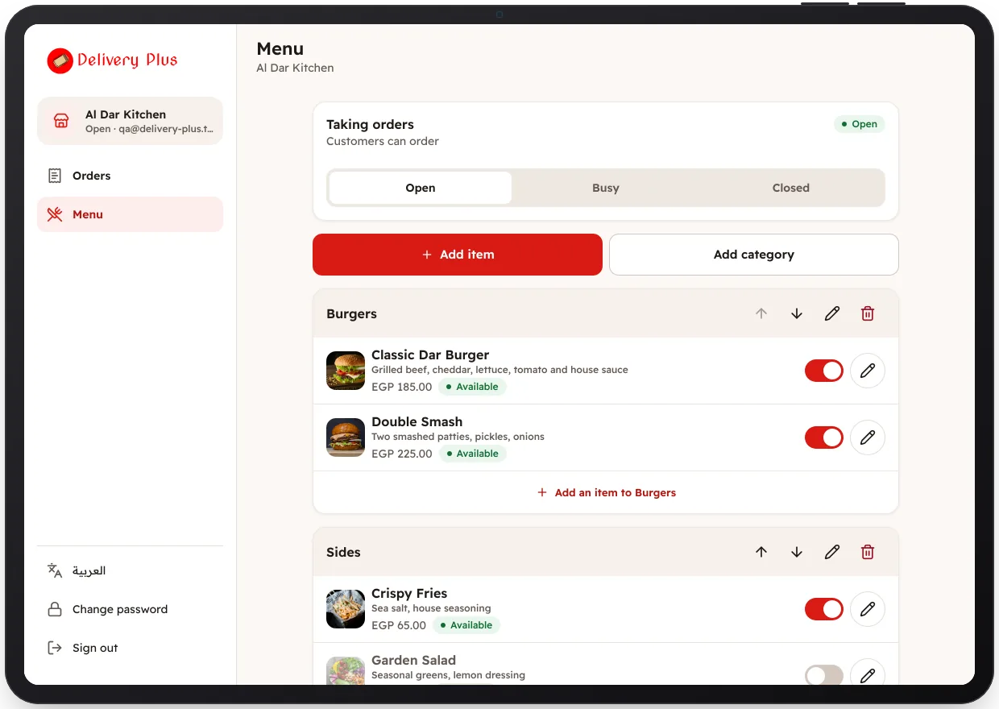

<!-- Generated from the app's web build (screens in docs/screens); regenerate rather than edit by hand. -->
[Restaurant app](../../../README.md) › [Screens](../README.md) › 9 of 10 · [العربية](../ar/09-menu.md)

<h1 align="center">Menu</h1>

Categories and items, availability, and Open, Busy or Closed.

<a href="08-reject-order.md">← Previous</a> &nbsp;·&nbsp; <b>9 / 10</b> &nbsp;·&nbsp; <a href="10-edit-item.md">Next →</a>

