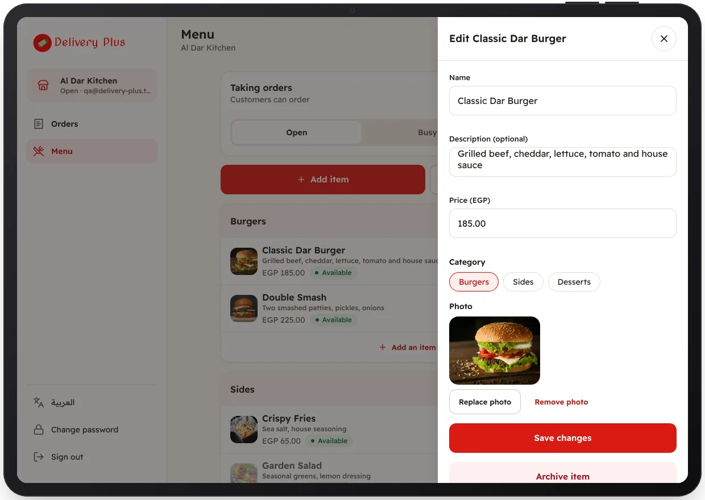

<!-- Generated from the app's web build (screens in docs/screens); regenerate rather than edit by hand. -->
[Restaurant app](../../../README.md) › [Screens](../README.md) › 10 of 10 · [العربية](../ar/10-edit-item.md)

<h1 align="center">Edit an item</h1>

Name, description, price, category and photo.

<a href="09-menu.md">← Previous</a> &nbsp;·&nbsp; <b>10 / 10</b> &nbsp;·&nbsp; Next →

