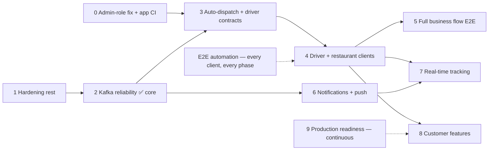

# Delivery Plus — Platform & Customer App Planning

_Last updated: 2026-10-02. Backend `dev`: #105–#111 merged (Phase 3 complete; #111 gateway dev CORS for the driver app). App repos on GitHub (private, default `dev`): customer app #1, #16, #17; driver app #13, #15, #16._

This plan covers the customer app (`delivery-plus-customer-app`), the driver app (`delivery-plus-driver-app`) and the backend (`delivery-plus`). It is rebuilt from the code and from what the automated runs actually showed. **Definition of done:** a change is done only when the right levels of verification pass: unit → integration (live API) → contract (OpenAPI) → UI/E2E → business flow. Each "done" below names the levels it has.

---

## 1. Where the project is now

**Overall: the backend carries an order from checkout to a driver without anyone calling the API, and a real driver app now takes it from there: a driver signs in, goes online, gets the job automatically and delivers it and shares their location while on the job (#99 steps 1–6, Maestro-verified locally and in GitHub CI). Left in #99: the cross-app customer run (step 7). Then the restaurant dashboard (#100).**

| Phase | State |
| --- | --- |
| 0 · Foundations (services, gateway, DBs, Compose, CI, migrations, OpenAPI) | ✅ done |
| 1 · Hardening | ✅ core merged (#102); the critical self-registered-ADMIN hole is fixed (#105); 6 follow-ups and the review findings F3–F11 remain open |
| 2 · Kafka reliability | ✅ core merged (#103); outbox (#98) and schema registry (#23) open |
| Phase 3 · Automatic dispatch + driver contracts | ✅ complete: #33 (#107), #95 (#108), #96 (#109), #97 (#110) |
| 4 · Driver + restaurant clients | 🔄 **in progress**: driver app #99 steps 1–6 merged (driver repo #15, #16); step 7 (cross-app run) open; then #100 restaurant dashboard |
| 5 · Full business flow E2E | ⚠️ dispatch is no longer a stand-in. The driver app's own business flow is real UI (customer + restaurant are stand-ins there); the customer app's business flow still uses driver and restaurant stand-ins. App E2E smoke runs in GitHub CI on PRs |
| 6 · Notifications + push | ⚠️ unblocked; payment/delivery handlers are still empty (#5) |
| 7 · Real-time tracking | ❌ blocked on Phase 4 (customer app polls every 10 s) |
| 8 · Customer product features | 📋 backlog |
| 9 · Production readiness | ⚠️ mostly missing: no metrics, no deploy pipeline, no backups, no graceful shutdown |

**What works today (verified):**
- **Customer journey:** sign in, browse, cart, checkout (now with a drop-off address), payment, order status, delivery stages, notifications. It runs through the real UI (Maestro, 9/9 flows) and through the API (`npm run e2e`).
- **Security:**
  - Public registration can't self-assign ADMIN; roles are an allow-list checked in the DTO and the service (#105).
  - Ownership checks on orders, deliveries, tracking and notifications; refunds are admin-only (#102).
- **Delivery pipeline (Phase 3):**
  - Automatic dispatch (#110): when the restaurant marks an order ready, delivery-service creates the delivery and assigns a driver itself; with no driver free, the delivery waits and is retried every 15 s.
  - A driver can only be claimed by one delivery at a time (compare-and-set), and a busy driver can't free themselves (#107).
  - Every order carries a drop-off address copied at checkout (#108).
  - A driver gets their job, with pickup, drop-off, items and next action, from `GET /api/deliveries/me/current` (#109).
- **Kafka reliability (#103):** events keyed by `orderId` with deterministic ids; durable deduplication in Redis (AOF); dead-letter topics with replay; retry-safe delivery actions.
- **Customer app (private repo, `dev`):** login sends one request per submit and shows actionable errors; development builds show which API they use; the E2E suites follow automatic dispatch. CI and the Maestro smoke suite run on GitHub.
- **Driver app (private repo, `dev`):** DRIVER-only sign-in, sign-up with first-use vehicle registration, online/offline toggle, current job from `me/current` (polled every 5 s on shift) with pickup, drop-off, items and the next action, then pickup → start → complete. Maestro: smoke 3/3 + business 1/1 locally; smoke green in GitHub CI.
- **Docs:** the engineering library (`docs/books`, #106) and the project context were updated with each PR.

**What is missing or wrong (verified):**
- **No restaurant client yet**, and the two app suites don't run together: the customer business flow still drives the driver by API, and the driver business flow still orders by API (dispatch is real in both).
- **The customer app shows no driver location yet** (Phase 7): the driver app sends it (#99 step 6) and the customer's tracking endpoint returns it, but there is no map or pin in the UI.
- **Driver choice is basic:** "most recently updated AVAILABLE driver", with no location, distance or fairness (F11).
- **No outbox (#98):** a crash between a DB commit and its publish loses the event. Since #110 that can leave a ready order without an automatic delivery (manual dispatch still works).
- **Delivery and payment event payloads have no `customerId`,** so customers get only the "order confirmed" notification (#5).
- **No production operations:** no metrics or alerts, no consumer-lag monitoring, no deploy pipeline or staging, no Postgres backups, no graceful shutdown.
- **Open review findings F3–F11 (§9):** error-message leak on 500, superuser DB access and root image, ADMIN system tokens on a shared secret, cart lost update, non-atomic rate limiter, TypeORM `undefined`-where trap, correlation ids.
- **App repos are private on the free plan:** branch protection/rulesets and CodeQL are unavailable there, so merges rely on the "all CI green" policy, not enforcement.

**The plan, in one line:** Phase 4: finish the driver app (#99: location, cross-app run) → the restaurant dashboard (#100) → replace the remaining E2E stand-ins → notifications → real-time tracking. The outbox (#98) and production readiness run alongside. Details are in §5 and §6.

---

## 2. Completed (verified)

| Item | What changed | Verified by |
| --- | --- | --- |
| **P0-1** App git + CI | Repo on `main`; CI runs typecheck, lint (0 warnings), vitest, web export | Fresh-clone run of all CI steps; green on GitHub (customer repo #1, #16) |
| **P0-2** Failed-payment race | One terminal state (`FAILED`); tolerant payment-event consumer; typed 409 handling | Unit (order + payment); live API; DB state; **UI: declined order shows Failed** |
| **P0-3** Delivery/tracking reads | JWT → order ownership → delivery; driver location self/admin only | Unit; live API (24 checks); **UI: another customer's order is refused** |
| **P0-4** Order → delivery lookup | `GET /api/deliveries/by-order/:orderId` | Unit; live API; OpenAPI; **UI: "Finding a driver" and delivery stages** |
| **P0-5** Delivery card (polling) | Order detail shows delivery progress, 10s polling | **UI: waiting state and every stage in the business flow** |
| **H1** Dispatch ownership | Create/assign/cancel: admin, or the owner of the order's restaurant (checked by order-service with the owner's token) | Unit (allowed + forbidden); live API (6 checks) |
| **H2** Driver profiles | `GET /drivers/available`: JWT + ADMIN (services use system tokens); `GET /drivers/:id`: driver themself or admin. tracking-service gained a system-token minter | Unit + guard metadata; live API (7 checks, incl. tracking still resolving drivers) |
| **H3** Cart rate limit | `RateLimitGuard` reads the handler limit, then the controller limit (the cart's class-level 30/min was ignored) | Unit regression; live: first 429 at request 31 |
| **H4** Notification ownership | Mark-read scoped to the owner, 404 otherwise; UUID validation (was a 500) | Unit; live API (3 checks) |
| **Refund authorization** (audit) | Refunds are admin/support-only; customers could refund their own completed payment at any time, even after delivery | Unit; live API |
| **Order status compare-and-set** (E2E finding) | `UPDATE … WHERE status = expected`; only the winning writer publishes. Fixed duplicate `order.confirmed` → duplicate notifications | Unit (concurrent writers); live: fresh env shows 2 notifications, 0 duplicates |
| **Kafka topic bootstrap** (E2E finding) | Consumers create their topic before subscribing. A fresh cluster used to crash driver-service (`delivery.events` did not exist yet) | Unit; live: cold start, 0 restarts |
| **Order detail crash** (E2E finding) | React Compiler evaluated `order!.id` during render while the order was loading → blank page | UI (every order flow); code comment |
| **Delivery card stuck loading** (E2E finding) | `useResource` treated a loaded `null` ("no delivery yet") as missing | Unit regression; UI |
| **E2E environment** | `docker-compose.e2e.yml` (project `delivery-plus-e2e`, gateway :3100, storage :9100, own volumes, payments always succeed), `npm run e2e:env:up/down/reset` | Cold start from empty volumes; seed; full UI run |
| **Deterministic seed** | `npm run seed:e2e`: 4 QA accounts, QA Kitchen / QA Night Cafe, scenarios S1–S4, id manifest; refuses non-localhost targets | Fresh env, 3 runs |
| **Maestro suites + runner + CI** | 9 flows, runner with control server, PR smoke / nightly full workflow | Local from-scratch run 9/9. GitHub: smoke green on PRs (#1, #16); nightly full run not yet observed |
| **Shared seed helpers** | `scripts/lib/gateway-seed.ts` used by `seed-demo` and `seed-e2e` | Both seeds run live (typecheck + execution) |
| **K1** Partition key | Producer keys every event by `payload.orderId` (fallback `correlationId`) | Unit; live: all 15 events of one order (order, payment, delivery) keyed by its id |
| **K2** Deterministic event ids | Order and delivery events: UUID v5 of `(entity id, event type)` | Unit; live (v5 ids on the wire) |
| **K3** Delivery events published | created / driver_assigned / picked_up / in_transit / completed / cancelled, after the HTTP syncs | Unit (every transition, ordering, nothing on rejection); live: 5 events per delivered order; E2E env seed |
| **K4** Tolerant delivery consumers | order-service applies delivery events like payment events (same status no-op, stale skipped). driver-service's release consumer removed (a late `completed` could free a busy driver) | Unit; live: 0 dead-lettered messages across seed + e2e |
| **K5** Durable idempotency | `KafkaConsumerService` claims each event in Redis per consumer group (order-service, notification-service); Redis AOF + volume | Unit (processed / in-progress / Redis down); live: offsets rewound, 6 redelivered events skipped, 0 duplicate notifications |
| **K7** Retry-safe delivery actions | Compare-and-set delivery writes; repeating an action re-runs its side effects instead of 409; driver released first, idempotently, never while on another delivery; lagging order catches up step by step; failed assignment gives the driver back. `maxHandlerAttempts` configurable | Unit (15 regression tests); live on the E2E stack: order-service down → driver still released, retry delivers; driver-service down → retry releases; 9/9 Maestro after reset |
| **K6** Dead-letter topics + replay | 3 attempts → `<topic>.dlq` with `dlq-*` headers; offset committed only once handled or dead-lettered; `npm run kafka:dlq -- <topic> [--replay]` | Unit (handler failure, poison message, DLQ send failure); live: forced failure + poison message dead-lettered, replay created the notification exactly once, second replay found nothing |
| **PR 1 merged** (#102) | `feat/hardening-e2e-env` → `dev` | All CI pipelines green; #52 closed |
| **PR 2 merged** (#103) | `feat/kafka-reliability` → `dev` | All CI pipelines green; #2 #3 #4 #43 #44 closed |
| **Mermaid fix** (#104) | README + `docs/architecture.md` diagrams render on GitHub (`-. label .->` → `-.->\|label\|`) | Mermaid parser; merged |
| **Engineering library** | `delivery-plus/docs/books`: 31 books, 82 labs (DB, RD, KF, DS, OPS, GEO, E2E, SEC), 21 case studies, 10 teaching ADRs, checkpoints, code-reading guide, roadmap. Docs only, no app changes | Script: every repo path, link and anchor resolves (0 problems, 76 files); Node labs executed; **Docker labs not executed**. Merged (#106) |
| **0a · self-registered ADMIN** (#105) | `SELF_SERVICE_ROLES` allow-list in `RegisterDto` (`@IsIn`) and `AuthService` (403); OpenAPI no longer offers ADMIN | Unit (+ mutation check), DTO pipe test, live: reproduced (ADMIN, 200 on admin route) then fixed (400, 0 rows); `npm run e2e` asserts it in CI |
| **#33 driver availability** (#107) | (from → to) role rules; compare-and-set claims; repeated online/offline/release are no-ops, BUSY never is; delivery-service tries the next driver on a lost claim | Unit incl. in-memory CAS race (+ mutation check); live: 3 simultaneous claims → 200,409,409; BUSY driver → 403 |
| **#95 delivery address** (#108) | Orders copy `deliveryAddress`/notes/coords at checkout (body or profile; 400 if none); migration 003 | Unit, DTO pipe, live (snapshot survives profile edits), `npm run e2e`, Maestro checkout |
| **#96 driver current delivery** (#109) | `GET /deliveries/me/current` (DRIVER only, own token): pickup, drop-off, items, next actions; 204 when none | Unit, controller, live in `npm run e2e`; Maestro 9/9 |
| **#97 automatic dispatch** (#110, merged) | Consumes `order.ready_for_pickup` (durable idempotency): create + assign; waiting deliveries retried by a sweep; concurrent create → 409; seeds/e2e no longer dispatch by hand; S3 becomes a runtime UI flow | Unit (+ mutation checks); `npm run verify` 444 tests; fresh E2E stack: Maestro 9/9 (incl. "waits for a driver, then assigned once one comes online", business flow with no dispatch stand-in); `npm run e2e`; live race/replay 5/5; GitHub CI 22/22 |
| **Login screen** (customer app) | One request per submit (ref guard), actionable 401/429 messages, error clears on edit, dev-only API hint | Unit (`describeLoginError`), typecheck, lint, Maestro login |
| **0b · app repos on GitHub** | Private repos `delivery-plus-customer-app` and `delivery-plus-driver-app`, default `dev` (+ `main`, `testing`), structured like the backend: README, CONTRIBUTING, SECURITY, CODE_OF_CONDUCT, CODEOWNERS, PR/issue templates, labels, `ci.yml`, `security.yml` (npm audit + Trivy), `e2e.yml`, Dependabot. Rulesets and CodeQL not available on private free-plan repos | GitHub CI green: customer #1 (4/4 incl. Maestro smoke); driver CI + Security on `main`/`dev`/`testing` |
| **Dependabot scope** (both apps) | Ignores `expo*`, `@expo/*`, `react*`, `react-native*` and TypeScript/ESLint majors (Expo SDK pins them; a lone react-native-reanimated bump failed CI); those move with `npx expo install --fix` | Customer #16, driver #13 merged with CI green; Dependabot closed the 17 now-ignored PRs itself |
| **#99 driver app, steps 1–5** (driver repo #15) | Scaffold (customer stack); DRIVER-only sign-in; sign-up + first-use vehicle registration; online/offline; current job (5 s poll on shift); pickup → start → complete following `nextActions`. Maestro runner on :8084/:8091; cleanup leaves the QA driver AVAILABLE for the customer suite | typecheck, lint, vitest 37/37; Maestro locally 4/4 (smoke 3/3, business 1/1: auto-dispatch → delivered → customer order DELIVERED); GitHub CI 4/4 incl. Maestro smoke |
| **#99 step 6 · location sharing** (driver repo #16) | While DRIVER_ASSIGNED / PICKED_UP / IN_TRANSIT the app sends its position every 10 s (foreground) to `POST /api/tracking/location`; the card shows sharing / permission off / retrying. Dev/E2E builds use `EXPO_PUBLIC_FIXED_LOCATION` (Maestro web can't grant or fake geolocation) | vitest 45/45 (send loop, permission denied, retry, stop; parser; API call); Maestro locally 4/4: the customer's `GET /api/tracking/delivery/:id` returns the driver app's position; GitHub CI 4/4 incl. Maestro smoke; merged `b2b8baf` |
| **Gateway dev CORS for :8084** (backend #111) | Default development origins include 8084 (driver app E2E web build); production still requires `CORS_ORIGINS` | Found by the driver Maestro run (sign-in blocked by preflight); unit 15/15; live preflight returns `Access-Control-Allow-Origin`; CI 22/22 |

---

## 3. Clients and what they use (verified in the repositories)

| Client | Exists | Services used | Complete workflows | Missing |
| --- | --- | --- | --- | --- |
| **Customer app** (Expo 57; web build under E2E) | ✅ | auth, users, restaurants, menus, cart, orders, payments, deliveries, notifications | sign in, browse/search, cart, checkout, order status + delivery polling, cancel, notifications, profile | avatar upload UI, push, live map, native (Android/iOS) E2E |
| **Restaurant dashboard** | ❌ | — | — | whole client (#100). Contract exists: owner order list, status transitions, menu/images; dispatch becomes automatic with #97 |
| **Driver app** (Expo 57; web build under E2E) | ✅ MVP | auth, drivers, deliveries, tracking | sign in (DRIVER only), sign up + vehicle, online/offline, current job, pickup → start → complete, location while on a job | background location, native (Android/iOS) E2E |
| **Admin / ops** | ❌ | Swagger, Kafka UI (dev) | — | whole client |

---

## 4. Current blockers (real, verified)

| # | Blocker | Blocks | Owner |
| --- | --- | --- | --- |
| B1 | **No restaurant client** (#100) | Real kitchen workflow; restaurant UI E2E | New client |
| B6 | Android/iOS E2E not set up (needs a development build + emulator; no Android SDK on this machine) | Native UI regression coverage | Platform |
| ~~B2~~ | ~~No driver client / no driver locations~~: **resolved** (#99 steps 1–6, driver repo #15, #16) | — | — |
| ~~B5~~ | ~~App repos have no GitHub remote~~: **resolved** (0b; app CI + Maestro smoke run on GitHub) | — | — |
| ~~B3~~ | ~~No auto-dispatch~~: **resolved** (#110) | — | — |
| ~~B4~~ | ~~Delivery events never published~~: **resolved** (K3). Remaining: payloads lack `customerId`, no outbox | — | — |
| ~~B7~~ | ~~A BUSY driver can set themselves AVAILABLE~~: **resolved** (#107) | — | — |
| ~~B8~~ | ~~Self-registered ADMIN~~: **resolved** (#105) | — | — |

---

## 5. Current sprint — Phase 4 · driver app MVP (#99)

Goal: a driver signs in, goes online, receives the automatically assigned delivery, picks it up, delivers it and sends locations, through a real app, with a Maestro suite from the first commit. 0a, 0c and Phase 3 are done (#105–#110).

**Status (2026-10-02):** 0b and steps 1–6 ✅ (driver repo #15, #16; backend #111; verification in §2). Step 7 is half done: the driver suite runs on the isolated stack and in CI, but the customer business flow still uses driver stand-ins. Step 7 is next.

| # | Issue | Work | Depends on | Done when |
| --- | --- | --- | --- | --- |
| 0b ✅ | B5 | Create the GitHub repos for the customer app and the driver app, push, set `BACKEND_REF` | owner's decision (name, visibility) | `ci.yml` green on GitHub; `e2e.yml` smoke green on a PR |
| 1 | #99 | Scaffold `delivery-plus-driver-app` with the customer app's stack (Expo Router, API client, session, `useResource`, theme) and CI checks (typecheck, lint, vitest) | — | App builds for web; checks pass |
| 2 | #99 | Sign in (DRIVER only) and first-use vehicle registration (`POST /drivers/register`) | 1 | Unit + Maestro |
| 3 | #99 | Online/offline toggle (`me/online`, `me/offline`; shows 403 "on an active delivery" while BUSY) | 2 | Unit + Maestro |
| 4 | #99 | Current delivery screen from `GET /deliveries/me/current` (204 → "waiting for a job"; polls while online): pickup, drop-off, items, the next action button | 3 | Unit + Maestro |
| 5 | #99 | Actions pickup → start → complete (retry-safe on the server; the button follows `nextActions`) | 4 | Maestro: online → assigned → delivered |
| 6 ✅ | #99 | Send location while on a delivery (`POST /tracking/location`, foreground interval) | 5 | Unit; tracking reads show it |
| 7 | #99 | E2E: driver-app Maestro suite on the isolated stack; the customer-app business flow drops its driver stand-ins (cross-app run) | 5 | Both suites green from a fresh environment |

Acceptance for the sprint (from #99): Maestro online → receives delivery → pickup → start → complete against the E2E stack; the customer business E2E no longer uses driver stand-ins; CI runs typecheck, lint, unit tests and Maestro smoke on PRs (needs 0b).

---

## 6. Phase roadmap (recalculated) — GitHub milestones

**Order change vs. the proposed path** (Hardening → Kafka → Restaurant + Driver workflows → Automatic dispatch → …): automatic dispatch and the driver contracts come **before** the clients. They are backend-only, the driver app's first screen depends on them (#95, #96), and auto-dispatch removes a manual step the restaurant client would otherwise have to implement and then delete. E2E is continuous; Phase 5 is where the API stand-ins in the business flow are replaced by real client steps.

| Milestone | Status | Open issues | Exit criterion (what "done" means) |
| --- | --- | --- | --- |
| Phase 1 · Hardening (remaining) | Core merged (#102). **New critical B8** | **new: registration role (B8)**; #42 checkout re-validation (canonical for #31 #40 #41 #47 #54); #53 cancellation + refund policy; #56 refund ledger; #18 stuck PROCESSING; #19 lease ownership; #59 owner data exposure. **New, unfiled (§9):** error-message leak on 500, cart lost update, atomic rate limiter | No privilege can be self-selected; every money path (cancel, refund, stuck payment) has a defined, tested end state |
| Phase 2 · Kafka reliability | Core merged (#103) | #98 outbox; #23 event schema registry | Order and delivery events are published if and only if the DB change commits; payload contracts are versioned |
| Phase 3 · Automatic dispatch + driver contracts | ✅ complete (#107–#110) | — (#33, #95, #96, #97 closed; milestone 0 open) | Orders reach a driver with no manual API call; the driver can find their job by API |
| Phase 4 · Driver + restaurant clients | **Current sprint**: driver app MVP merged (steps 1–6); step 7 open | #99 driver app, #100 restaurant dashboard | Both apps ship with `testID`s, a Maestro smoke suite and CI from the first commit |
| Phase 5 · Full business flow E2E | Partly (stand-ins) | #13 (notification assertion; app E2E in CI) | The business flow runs through three real UIs in CI; no API stand-ins left |
| Phase 6 · Notifications + push | **Unblocked** (#103 merged) | #5, #50, #51 | `customerId` in payment/delivery payloads; a notification for every customer-visible stage; push on mobile |
| Phase 7 · Real-time tracking | Blocked on Phase 4 | #32, #46, #60 | Moving driver pin from real driver locations (SSE/WebSocket, with polling as fallback); location stops after delivery |
| Phase 8 · Customer product features | Backlog | #34, #35, #48, #58 (+ avatar upload UI, reorder: app-only) | Refresh tokens, password recovery, opening hours, stock windows |
| Phase 9 · Production readiness | Backlog (runs alongside) | #6, #7, #8, #14, #15, #16, #20, #30, #37, #38, #101. **New, unfiled (§9):** service identity instead of ADMIN system tokens, DB least privilege, TypeORM undefined-where guard, correlation ids across HTTP + Kafka | Staging + deploy pipeline; metrics, lag and DLQ alerts; tested backup/restore; graceful shutdown; per-service DB roles; non-root image |

### Future plan: the order of work and why

1. ~~**Security + library (0a, 0c)**~~: done (#105, #106). ~~**0b (app repos on GitHub)**~~: done (private repos, CI green).
2. ~~**Phase 3: dispatch + driver contracts**~~: complete (#107–#110). #33 came first so that auto-dispatch builds on an exclusive driver claim.
3. **Phase 2 finish: outbox (#98)** in parallel with Phase 4. Auto-dispatch makes delivery depend on `order.ready_for_pickup` being published, so a lost event now means a stuck order. The outbox becomes necessary once dispatch is event-driven.
4. **Phase 4 (now): driver app (MVP merged; location + cross-app run left), then restaurant dashboard.** The driver app first, because it supplies real location data for Phase 7 and replaces three of the five stand-in steps.
5. **Phase 5: replace the stand-ins** as each client lands. The Maestro business flow becomes cross-app.
6. **Phase 6: notifications.** Add `customerId` to the payloads (or look it up), fill the empty handlers (#5), then retries, preferences and push.
7. **Phase 7: real-time tracking.** Only once drivers send locations. Start with SSE or WebSocket for the moving pin, keep polling as the fallback, and make the location stale-aware (#32).
8. **Phase 8: product features**, by user demand.
9. **Phase 9 continuously,** with this priority: metrics + consumer-lag/DLQ alerts (#15) → graceful shutdown (#7) → HTTP timeouts (#6, #38) → backups (#16) → container/DB least privilege (#14) → staging + deploy pipeline. Production launch is gated on these, not on Phase 8.

**Later (FUTURE, no commitment):**
- Nearest-driver dispatch with Redis GEO or PostGIS once orders have coordinates (#95).
- Batch assignment at high volume.
- More Kafka partitions, plus replication, before scaling consumers.
- Read models / a BFF so an order screen is one request.
- Kubernetes only once there is a team to operate it.

(Design notes for each of these are in `delivery-plus/docs/books`, case studies 12, 13, 19 and 20 and ADR 0010.)

**Why tracking moved behind operator clients:** real-time tracking needs (a) published delivery events, (b) a driver client sending locations, and (c) auto-dispatch so there's something to track without a person driving the API. None of those exist yet.

---

## 7. E2E automation (permanent)

| Aspect | Current state |
| --- | --- |
| **Framework** | Maestro CLI 2.11 (web support is beta; Chromium). Chosen because it drives React Native on Android/iOS and web with one YAML syntax. No other E2E framework existed in either repo |
| **Supported clients** | Customer app (web :8083, control :8090) and driver app (web :8084, control :8091), **web builds**, on the same E2E stack. Android/iOS: flows use platform-neutral `id:` selectors (`testID` + `nativeID`), but no emulator job yet (B6). Restaurant: no client |
| **Environment** | Compose project `delivery-plus-e2e` (base + test + e2e overlays): isolated DB/Redis/Kafka/object-storage volumes, gateway `:3100`, storage `:9100`, `PAYMENT_SUCCESS_RATE=1`. Runs next to the dev stack. `npm run e2e:env:reset` = down → up → seed |
| **Deterministic seed** | `npm run seed:e2e`: `qa.customer`, `qa.customer2`, `qa.restaurant`, `qa.driver` @`delivery-plus.test` (test-only password via `E2E_PASSWORD`, localhost-only guard); QA Kitchen (fixed prices; one sold-out item), QA Night Cafe (closed); scenarios S1 delivered, S2 payment declined, S3 ready without a delivery, S4 another customer's order; manifest of generated ids |
| **Smoke (PR)** | login → Home · search → restaurant → menu · add → quantity → total · cart → checkout → order |
| **Regression (nightly)** | waiting-for-driver state · declined → Failed · another customer's order refused · gateway outage → offline state → recovery with session intact |
| **Business (nightly)** | customer UI orders → restaurant prepare/ready → dispatch → driver pickup/start/complete → customer UI: Delivered + notification |
| **Runner** | `e2e/scripts/run.mjs`: builds web against the E2E gateway (`--clear`), serves it, hosts a control server for stand-ins/fault injection, clears rate-limit keys (E2E Redis only), runs flows asynchronously |
| **Driver suites** | smoke: sign-in, online/offline, new driver + vehicle · business: online → auto-dispatched job → pickup → start → complete → customer order DELIVERED (customer + restaurant are API stand-ins) |
| **CI** | Both apps: `ci.yml` (code checks, every push/PR) + `e2e.yml` (PR: smoke; nightly/manual: all). Starts the backend E2E stack from `BACKEND_REF`, seeds, runs headless. Smoke green on GitHub in both repos |
| **Failure artifacts** | JUnit per flow, screenshots and debug output per flow (`e2e/.artifacts`), backend compose logs on failure. Uploaded 14 days |
| **Known limits** | Maestro web cannot scroll react-native-web lists (it scrolls the window; RN-Web keeps `body` overflow hidden), so headless runs use a 430×1600 viewport. Restaurant/driver steps are API stand-ins (labelled in the flow). Checkout decline can't be triggered from the UI (no payment input); covered via seeded S2 |
| **Runtime** | ~7.7 min for all 9 flows locally (login dominates) |

**Rule for new work:** every client gets `testID`s, a Maestro suite and CI from its first commit. Every critical business flow gets E2E coverage before it is called done.

---

## 8. Business-flow verification

| Flow | Automatically verified | How | Not verified |
| --- | --- | --- | --- |
| Customer order cycle (sign in → browse → cart → checkout → order) | ✅ | UI (smoke) | — |
| Restaurant prepares / ready | ⚠️ | API stand-in inside the business flow | No restaurant UI |
| Dispatch + driver assignment | ✅ | Automatic dispatch (#110) in both apps' business flows | Driver choice is basic (F11) |
| Driver pickup / in transit / delivered | ✅ / ⚠️ | Driver app UI (driver business flow); still an API stand-in in the customer business flow | Cross-app run; no location streaming |
| Customer sees delivery progress + Delivered | ✅ | UI (business flow, via polling) | Real-time push |
| Notification after the order | ✅ | UI (Alerts shows "…has been confirmed") | Other notification types don't exist |
| Payment decline | ✅ | UI (seeded S2) + API | Declining from the UI |
| Authorization (other customer's order) | ✅ | UI + live API checks | — |
| Temporary outage | ✅ | UI with gateway stopped/started | Slow network / partial failures |
| Critical path via API only | ✅ | `npm run e2e` in backend CI | — |

### Flow reference (source → destination, protocol, owner, events, storage, auth)

| Flow | Path | Protocol | Data owner / storage | Events | Auth boundary |
| --- | --- | --- | --- | --- | --- |
| Order | App → Gateway → order-service (→ cart, restaurant) → payment-service → order (HTTP sync + `payment.*` consumer, compare-and-set) → notification-service | HTTP + Kafka | order/payment DBs, cart in Redis | `order.*`, `payment.*` | JWT; ownership in each service |
| Kitchen | (stand-in) owner → order-service | HTTP | order DB | `order.preparing`, `order.ready_for_pickup` (no consumers) | JWT owner + restaurant ownership |
| Delivery | owner → delivery-service (→ order-service with owner token; → driver-service with system token) → driver → delivery-service | HTTP + Kafka | delivery + driver DBs | `delivery.*` (created → completed/cancelled); order-service converges from them | Dispatch: admin or the order's restaurant owner; driver actions: assigned driver |
| Tracking | driver → tracking-service → Redis (last location, 300s TTL); customer → tracking-service → delivery-service (user token) | HTTP (no push) | Redis | — | Driver: own location; customer: via delivery ownership |
| Media / profile | App → user-service (presign) → S3 (direct POST to `pending/`) → user-service (confirm: byte check, content-addressed copy) → `avatarUrl` | HTTPS | S3 + user DB | — | JWT; key prefix bound to the requester |

---

## 9. Architecture reviews

### Kafka (verified in code)

| Area | Finding | Needed before real-time |
| --- | --- | --- |
| Delivery lifecycle events | ✅ Published on every transition (K3); order-service converges tolerantly; driver-service no longer consumes | — |
| Durable idempotency | ✅ Wired, per consumer group in Redis; Redis AOF + volume (K5) | — |
| DLQ / replay | ✅ `<topic>.dlq` + `npm run kafka:dlq` (K6) | — |
| Event ids | ✅ Deterministic for payment, order and delivery (K2) | — |
| Payloads | Order has `customerId`/`restaurantId`; payment and delivery don't | ✅ add (for notifications) |
| Partitioning / order | ✅ Keyed by `orderId` (K1) | — |
| Outbox | None: order/delivery publish after commit (lost on crash); payment re-publishes via status markers | ✅ for order/delivery |
| Shutdown | No graceful shutdown hooks: stopped consumers linger in the group ~30 s | Nice to have |
| Topic provisioning | Fixed: consumers ensure topics (default 1 partition, broker defaults) | Explicit partitions/replication in prod |
| Double writers | HTTP sync + consumers for payment statuses; now safe (compare-and-set, tolerant consumer) | Keep until the outbox makes events authoritative |

### S3 / media (verified)

| Entity | Client | API (presign → confirm) | Storage → DB | Authorization | Verified live |
| --- | --- | --- | --- | --- | --- |
| Customer avatar | Customer app: **no upload UI** | `POST /users/me/avatar/image-upload-url` → `…/confirm` | `users/<id>/avatar/<sha256>` → `user_profiles.avatarUrl` | JWT; prefix bound to own id | ✅ (seed:demo) |
| Restaurant cover/logo | None (API/seed) | `POST /restaurants/:id/image-upload-url` → `…/image-confirm` | `restaurants/<id>/<type>/…` → `coverImageUrl`/`logoUrl` | RESTAURANT_OWNER + ownership on both steps | ✅ cover (seed:demo) |
| Menu item image | None | `POST /menus/menu-items/:id/image-upload-url` → `…/image-confirm` | `restaurants/<rid>/menu-items/<id>/…` → `imageUrl` | Owner + restaurant ownership on both steps | ⚠️ no seed exercises it |

Failure handling: presign policies enforce content type and size; confirm re-verifies the bytes; `pending/` expires after 1 day. **Gaps:** replaced images are never deleted; an object copied before a failed DB write is orphaned (documented); dev/E2E URLs are `localhost:9000`/`:9100`, which Android emulators and devices can't reach. No redesign needed.

### Codebase review (2026-10-01, found while writing the engineering library)

Every row was checked in the code. **None of these is fixed yet, and none except the existing issue numbers is filed on GitHub.**

| # | Finding | Severity | Where | Proposed fix | Tracked |
| --- | --- | --- | --- | --- | --- |
| ~~F1~~ ✅ fixed (#105) | **Public registration accepted `role: ADMIN`** (and self-selected RESTAURANT_OWNER/DRIVER without vetting) | 🔴 Critical | `services/auth-service/src/dto/register.dto.ts`, `services/auth.service.ts` | Allow-list self-service roles; admins out of band; audit existing admins; negative tests | **B8, sprint 0a**; file an issue |
| ~~F2~~ ✅ fixed (#107) | Driver status update was a blind write, so two concurrent assigns can mark the same driver BUSY for two deliveries | High | `driver-service` `updateStatus` / repository | Compare-and-set claim (`WHERE status = 'AVAILABLE'`) | #33 (extend) |
| F3 | Unknown errors return their raw `Error.message` on 500 (can leak SQL/driver details) | Medium | `shared/src/nest/filters/http-exception.filter.ts` | Generic message for non-`AppError`/`HttpException`; log the detail with the correlation id | file (Phase 1) |
| F4 | Every service connects as the `postgres` superuser; the image has no `USER`, so it runs as root | Medium | `docker-compose*.yml`, `Dockerfile` | Per-service DB roles limited to their own DB; non-root user in the image | #14 (extend) |
| F5 | System tokens are minted with the shared `JWT_SECRET` and role `ADMIN`. Any service (or a leaked `.env`) can become any user; audit logs can't tell services from admins | Medium | `services/{payment,delivery,tracking}-service/src/common/system-token.service.ts` | Asymmetric JWT signing (only auth-service signs) and a `SERVICE` role with narrow permissions, or the HMAC internal-route pattern of ADR 001 | file (Phase 9) |
| F6 | Cart is read-modify-write JSON in Redis, so two concurrent adds can lose one | Low | `cart-service` repository | `WATCH`/`MULTI` or a Lua script, or a hash per cart | file (Phase 1) |
| F7 | Rate limiter does `INCR` then `EXPIRE` (not atomic): a crash in between leaves a key with no TTL, and that user stays limited. The guard fails closed (5xx) when Redis is down | Low | `shared/src/redis/rate-limiter.service.ts`, `rate-limit.guard.ts` | One Lua script or `SET NX EX` + `INCR`; decide fail-open vs fail-closed per route | file (Phase 1) |
| F8 | TypeORM 0.3 ignores `undefined` values in `find` where-clauses by default, so `findOne({ where: { id: undefined } })` returns an arbitrary row. No current bug was found, but it's a trap | Low (latent) | all TypeORM data sources | Set `invalidWhereValuesBehavior: { undefined: 'throw' }` in the shared TypeORM config | file (Phase 9) |
| F9 | Correlation ids propagate only auth → user, not across other HTTP calls or Kafka | Low (ops) | service clients, Kafka producer | Forward `x-correlation-id` in every client; put it in event headers | #15 (extend) |
| F10 | Notification handlers for `payment.completed` and `delivery.driver_assigned` are empty (no `customerId` in those payloads) | Product gap | `notification-service/src/services/notifications.service.ts` | Add `customerId` to the payloads, or look it up from order-service | #5 |
| F11 | Dispatch picks the "most recently updated AVAILABLE driver" and ignores location: unfair and not nearest | Product gap | `driver-service` `findAvailable` | Fairness first (longest-idle), then nearest once orders have coordinates | #97 / Phase 7+ |

---

## 10. Production readiness

| Area | Exists | Gap |
| --- | --- | --- |
| Deployment | Image builds + Trivy scans; prod compose overlay | No deploy pipeline, no staging |
| Rollback | — | No rollback procedure; migrations have no down-path policy |
| Staging | — | None (the E2E stack is the closest parity environment) |
| Observability | Structured logs, correlation-id middleware | No log aggregation; correlation ids not propagated across service HTTP calls or Kafka |
| Tracing / metrics | — | No OpenTelemetry, no metrics, no Kafka consumer-lag monitoring |
| Health | `/health`, `/health/live`, `/health/ready` per service | Gateway liveness only; no graceful shutdown hooks |
| Resilience | Kafka consumer retries (3×) | No HTTP timeouts, retries or circuit breakers between services |
| Backups / recovery | Redis AOF on a volume (Compose) | No Postgres backups, restore drill or DR plan; no managed/replicated Redis |
| Secrets | `.env`, prod overlay requires secrets | No secrets manager or rotation; one shared `JWT_SECRET` also mints service tokens (F5) |
| Security | CodeQL, `npm audit`, Trivy; authz hardening + tests | 🔴 **Self-registered admin (F1/B8)**; no DAST; no audit log; authz regression checks exist only as unit tests + local scripts |
| Least privilege | — | Services use the `postgres` superuser; container runs as root (F4) |
| Rate limiting | Redis limiter on auth, orders, cart | No gateway-level limit |
| E2E in CI | Both app repos run Maestro smoke on PRs against the backend `dev` E2E stack | Nightly full runs not yet observed; no branch protection to enforce them (private free plan) |
| Analytics | — | No event warehouse |

---

## 11. Future enhancements (product, beyond required work)

- **Customer:** saved addresses with a geocoded pin, reorder, favorites, ratings/reviews after delivery, coupons, scheduled orders, Arabic/RTL, dark mode (needs a light wordmark), richer tracking (ETA, driver card, route), saved payment methods, in-app support chat.
- **Driver:** background location, hand-off to a navigation app, proof of delivery (photo via the existing S3 flow), OTP confirmation at the door, shift and availability planning, earnings, offer/accept flow.
- **Restaurant:** kitchen display, prep-time estimates, opening hours (status is manual today), stock/out-of-stock scheduling (availability toggle exists), sales analytics, restaurant-funded promotions.
- **Platform:** geospatial search and delivery radius (PostGIS), fuzzy search, pricing engine and dynamic delivery fees, recommendations, fraud detection (payments, promo abuse), Kafka → warehouse analytics, feature flags, multi-region readiness.

---

## 12. Verification log (2026-09-30)

| Area | Command / check | Result |
| --- | --- | --- |
| Backend unit | `npm test` (13 workspaces) | 357 passed, 15 skipped (DB-integration suite) |
| Backend build / lint | `npm run build`, `npm run lint` | Pass; 0 errors in all workspaces |
| Contract | `npm run openapi:generate` + `openapi:validate` | 56 paths valid (drivers/refund auth updated) |
| Compose | `docker compose … config --quiet` (dev, test, e2e) | Valid |
| Live hardening | gateway checks against the dev stack | 18/18 (cart limit re-checked on a clean window: 429 at request 31) |
| E2E env | `npm run e2e:env:reset` from empty volumes | Healthy, 0 restarts; seed OK; 2 notifications, 0 duplicates |
| UI / E2E | `node e2e/scripts/run.mjs --suite all --build --headless` after reset | **9/9 passed**, 9 JUnit reports, 0 failures |
| App code checks | typecheck, lint, vitest | Pass; 40 unit tests |
| Backend unit (Kafka phase, 2026-10-01) | `npm test`, `npm run build`, `npm run lint` | 385 passed, 15 skipped; build OK; 0 lint errors |
| Kafka live (dev stack) | seed + `npm run e2e`; topic dump; offset rewind; forced failure + replay | Keys = `orderId`; 5 delivery events/order; 0 DLQ entries in normal flow; 6/6 redeliveries skipped; replay → exactly 1 notification |
| UI / E2E (Kafka phase) | `e2e:env:reset` from empty volumes, then all Maestro suites | **9/9 passed** (business flow now emits delivery events at every step); afterwards 0 dead-lettered messages, 5 notifications / 0 duplicates, 0 container restarts |
| UI / E2E (retry-safe delivery, 2026-10-01) | `e2e:env:reset`, all Maestro suites | **9/9 passed** |
| Delivery failure injection (E2E stack) | stop order-service / driver-service during `complete`, then retry | 11/11 checks: driver released, order DELIVERED, no duplicate notifications, 0 dead letters |
| UI / E2E (#97, 2026-10-02) | fresh `e2e:env:reset`, then all Maestro suites | Reset passes; **9/9 passed** (smoke 4/4, regression 4/4 incl. "waits for a driver, then assigned once one comes online", business cycle with no dispatch stand-in) |
| API + live checks (#97) | `npm run seed` + `npm run e2e` on the E2E stack; race/replay script | e2e passes (auto-dispatch assigned the seeded driver; manual create → 409). Race → exactly one delivery; waiting delivery assigned 1.1 s after a driver came online; replayed `ready_for_pickup` → no second delivery or driver; 0 dead letters |
| GitHub CI (#110) | all pipelines | 22/22 passed; merged 2026-10-02 (`f0c876b`) |
| Driver app UI / E2E (2026-10-02) | `node e2e/scripts/run.mjs --suite all --build --headless` on the E2E stack (backend `dev` + #111) | First run 0/2 before stopping: sign-in blocked by CORS (:8084 not allowed) → fixed in #111. Re-run **4/4 passed** (smoke 3/3, business 1/1); QA driver left AVAILABLE |
| Driver app checks | typecheck, lint, vitest | Pass; 37 unit tests |
| Driver app, location sharing (2026-10-02) | vitest; `run.mjs --suite all --build --headless`; driver PR #16 CI | 45/45; **4/4 passed** (incl. customer tracking read shows the driver position); CI 4/4, merged |
| GitHub CI (apps, 2026-10-02) | customer #1, #16; driver #13, #15; backend #111 | All green and merged (driver #15: 4/4 incl. Maestro smoke 12 min; backend #111: 22/22) |
| GitHub CI (2026-10-01) | PRs #102, #103, #104 | All pipelines green; merged into `dev`; linked issues closed |
| Engineering library (2026-10-01) | path/link/anchor checker over `docs/books`; Node labs | 0 problems in 76 files; GEO labs pass. Docker labs not run (no Docker daemon in that session) |
| Code review findings (2026-10-01) | read against the code (§9) | F1–F11 confirmed in code; **F1 not yet reproduced live** |

---

## 13. Planning changes in this revision

**2026-10-02 (#99 step 6):**
- Location sharing merged (driver repo #16); B2 resolved. The customer app still has no location UI (Phase 7); step 7 (cross-app run) is next.

**2026-10-02 (app repos + driver app MVP):**
- 0b done: both apps are private GitHub repos structured like the backend; B5 resolved. Rulesets/CodeQL are unavailable on private free-plan repos (recorded, not applied).
- Phase 4 in progress: #99 steps 1–5 merged with a Maestro suite (driver repo #15). B2 narrowed to "no locations sent yet".
- Backend #111: gateway dev CORS allows the driver app's E2E origin (:8084), found by the first driver Maestro run.
- Dependabot no longer bumps Expo-managed packages one at a time (customer #16, driver #13).

**2026-10-02 (Phase 3 complete):**
- 0a (#105) and 0c (#106) done. Phase 3 complete: #33 (#107), #95 (#108), #96 (#109), #97 (#110). #110 merged after all live checks passed and GitHub CI was green (22/22).
- Blockers B3, B7 and B8 resolved; F1 and F2 fixed. B2 is now only "no driver client". B5 now covers both app repos.
- §5 is the Phase 4 sprint: driver app MVP (#99), in seven steps, each verified with Maestro.
- The E2E fixture S3 ("waiting for a driver") became a runtime UI flow, because a seeded waiting order would be assigned automatically.
- Customer app: login fixes (a ref guard against double submits, actionable errors, dev API hint); E2E runner and flows follow automatic dispatch.

**2026-10-01 (PRs merged + code review):**
- §1 rewritten as a status snapshot per phase, with what works and what's missing.
- PRs #102, #103 and #104 merged; Phase 1 and Phase 2 cores are on `dev`; Phase 6 unblocked.
- New critical blocker **B8** (self-registered admin). The sprint now starts with 0a (fix), 0b (app repo on GitHub so E2E CI runs) and 0c (library PR).
- New §9 *Codebase review* table: F1–F11. Unfiled findings are assigned to phases; #33, #14 and #15 extended in scope.
- §6 adds exit criteria per phase and a written future plan with the reasons for the order. The outbox moves next to Phase 4, because auto-dispatch makes delivery depend on one event being published.
- B5 narrowed: only the app repo's missing remote is left.

**2026-10-01 (retry safety + issue reconciliation):**
- Found and fixed: a failed side effect after a delivery was marked done left the driver BUSY permanently (retries got 409). Added K7.
- GitHub reconciled (§6):
  - 56 issues reviewed: 5 closed as done, 6 as duplicates.
  - #42 made canonical for checkout re-validation.
  - 6 new issues: #95 delivery address, #96 current delivery, #97 auto-dispatch, #98 outbox, #99 driver app, #100 restaurant dashboard.
  - 9 phase milestones.
- Roadmap order changed: auto-dispatch and driver contracts before the clients (reason in §6).
- New blocker B7 (#33): drivers can free themselves while busy.

**2026-10-01 (Kafka reliability):**
- Phase 2 core marked done (K1–K6); B4 resolved.
- Current sprint now starts Phase 3 (auto-dispatch, driver contract), which can build on reliable delivery events.
- Remaining Kafka work narrowed to: outbox, `customerId` in payloads, graceful shutdown.
- Design decision recorded: driver availability stays synchronous (delivery-service → driver-service); no event-driven release.

**2026-09-30:**

- Added: hardening results, five E2E-found defects, the permanent **E2E automation** section, **business-flow verification**, Kafka and S3 reviews, **current blockers** and **current sprint**.
- Phase 1 (Hardening) marked done; Kafka reliability is now the next phase and a hard prerequisite for dispatch, notifications and tracking.
- Real-time tracking stays after operator clients: it needs a driver client and published delivery events.
- New rule: every client ships with `testID`s, a Maestro suite and CI; stand-ins in the business flow are replaced as the restaurant and driver clients land.
- Production readiness moved into its own tracked section, separate from product enhancements.
